# 📊 TÀI LIỆU KIẾN TRÚC HỆ THỐNG: SƠ ĐỒ NGỮ CẢNH & DFD MỨC 0 ĐẾN MỨC 5
## Hệ Thống Quản Lý Thư Viện HDPE (Laminas Framework)

> **Dự án:** Quản lý Thư viện Số & Mượn Trả Sách (HDPE Library)  
> **Phiên bản kiến trúc:** 2.0 (Chuẩn hóa 2026)  
> **Xem trực tiếp trên trình duyệt:** [http://localhost/laminas-app/laminas-app/public/dfd.html](http://localhost/laminas-app/laminas-app/public/dfd.html)

---

## 0. Bức Tranh Toàn Cảnh: Hợp Nhất 6 Mức DFD (Từ Ngữ Cảnh Đến Bán Dẫn Silicon)

Sơ đồ kiến trúc phân cấp toàn cảnh **(Panoramic Multi-Tier DFD Architecture)** tổng hợp toàn bộ 6 cấp độ phân rã của Thư viện HDPE trên một bức tranh duy nhất: từ ranh giới tác nhân bên ngoài **(Mức Ngữ Cảnh 0.0)**, 5 phân hệ cốt lõi & 6 kho dữ liệu **(Mức 0 & 1)**, quy trình nghiệp vụ liên hoàn **(Mức 2)**, vi mô giải thuật logic **(Mức 3)**, hạt nhân hệ điều hành & database engine **(Mức 4)**, cho đến tầng vật lý bán dẫn & vi kiến trúc CPU **(Mức 5)**.

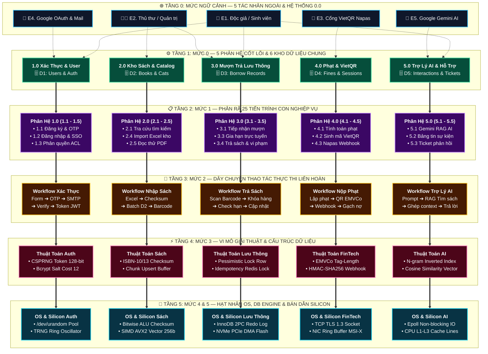

### Bảng Đối Chiếu 5 Trục Kiến Trúc Dọc (Vertical Architecture Pipelines)

| Trục Kỹ Thuật (Pipeline) | Tầng 0 (Ngữ cảnh) | Tầng 1 (Mức 0/1) | Tầng 2 (Quy trình) | Tầng 3 (Giải thuật) | Tầng 4 (Hạt nhân OS/DB) | Tầng 5 (Vật lý Silicon) |
|---|---|---|---|---|---|---|
| **1. Xác thực & Bảo mật** | Độc giả (E1) / Google SSO (E4) | 1.0 Quản lý User & Kho D1 | 1.1 OTP Email & Google OAuth | CSPRNG Token & Bcrypt Hash Salt | /dev/urandom & Eksblowfish Core | Nhiệt lượng tử & Ring Oscillator TRNG |
| **2. Dữ liệu Sách & Batch** | Thủ thư / Quản trị (E2) | 2.0 Quản lý Kho & Kho D2 | 2.4 Nhập kho Excel hàng loạt | ISBN-10/13 Modulo Checksum | Bitwise ALU & Branch Predictor | Superscalar OoO Pipeline & SIMD AVX2 |
| **3. Lưu thông & Đồng thời** | Độc giả (E1) / Thủ thư (E2) | 3.0 Quản lý Mượn-Trả & Kho D3 | 3.4 Trả sách kiểm kê & Hư hỏng | Pessimistic Lock & Idempotency Key | InnoDB Next-Key Lock & 2PC Redo Log | NVMe PCIe DMA & 3D TLC NAND Flash |
| **4. FinTech & Thanh toán** | VietQR / Napas Gateway (E3) | 4.0 Quản lý Phạt & Kho D4 | 4.2-4.4 Sinh QR & Webhook IPN | Chuỗi EMVCo & HMAC-SHA256 | TCP TLS 1.3 & Nonce Crypto Socket | NIC Ring Buffer, MSI-X & PHY Transceiver |
| **5. AI & I/O Bất đồng bộ** | Độc giả (E1) / Gemini API (E5) | 5.0 Trợ lý AI & Kho D5 | 5.1 RAG Hybrid & Hỏi đáp AI | Vector Search & Cosine Scoring | Linux Kernel Epoll & Socket Polling | L1-L3 Cache Lines, MESI & DRAM Burst |

---

## 1. Sơ Đồ Ngữ Cảnh (Context Diagram / DFD Mức Ngữ Cảnh)

Sơ đồ ngữ cảnh xác định phạm vi và ranh giới hoạt động của Hệ thống Quản lý Thư viện HDPE. Hệ thống được biểu diễn dưới dạng **một tiến trình trung tâm duy nhất (0.0)** tương tác trực tiếp với **5 Tác nhân ngoài (External Entities)**:

1. **👤 Độc Giả / Sinh Viên (Student / Reader):** Tra cứu sách, đọc thử PDF, gửi yêu cầu mượn, gia hạn, nộp phạt qua VietQR, gửi ticket hỗ trợ, trò chuyện cùng trợ lý AI.
2. **👨‍💼 Thủ Thư / Quản Trị Viên (Librarian / Admin):** Quản lý kho sách, nhập sách bằng file Excel, phê duyệt phiếu mượn, ghi nhận trả sách, xử lý khoản phạt, phản hồi ticket, đăng thông báo bảng tin, cấu hình tham số hệ thống.
3. **🏦 Hệ Thống VietQR & Cổng Ngân Hàng (VietQR / Napas):** Tiếp nhận yêu cầu sinh mã VietQR động chứa số tiền nộp phạt và mã định danh giao dịch `HDPE{fineId}X{hex}`, gửi thông báo chuyển khoản / biến động số dư.
4. **🌐 Dịch Vụ Google / Gmail API / SMTP:** Cung cấp xác thực đăng nhập một chạm Google OAuth (SSO), tiến trình Gmail Polling tự động quét thư ngân hàng báo có tiền để gạch nợ tự động, và máy chủ SMTP gửi OTP/email thông báo.
5. **🤖 Trợ Lý Google Gemini AI (Gemini 1.5/2.0 Flash):** Xử lý ngôn ngữ tự nhiên, gợi ý đầu sách theo ngữ cảnh, tóm tắt và hỗ trợ bạn đọc 24/7.

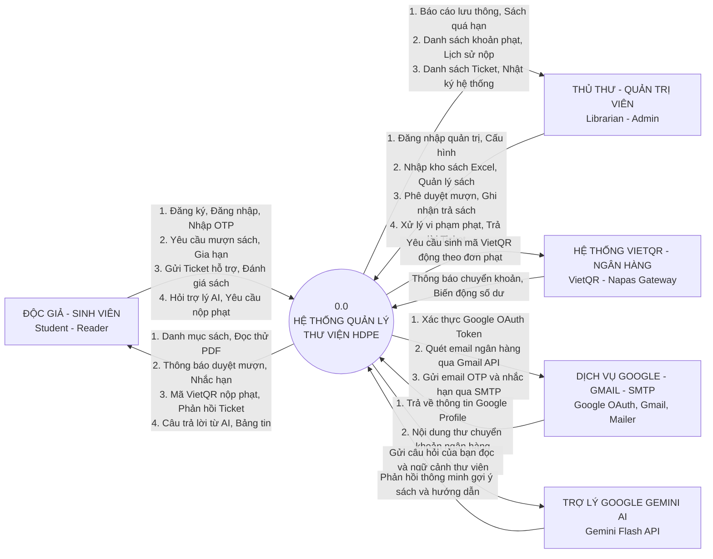

---

## 2. Sơ Đồ Luồng Dữ Liệu DFD Mức 0 (Level 0 DFD)

Khi phân rã tiến trình trung tâm `0.0`, hệ thống bao gồm **5 tiến trình chức năng con (1.0 → 5.0)** tương tác với **6 kho dữ liệu cốt lõi (D1 → D6)**:

### 2.1 Biểu Đồ Mermaid DFD Mức 0

```mermaid
graph TB
    subgraph ENTITIES["TÁC NHÂN NGOÀI"]
        E_STUDENT["ĐỘC GIẢ - SINH VIÊN"]
        E_ADMIN["THỦ THƯ - QUẢN TRỊ VIÊN"]
        E_BANK["HỆ THỐNG VIETQR - NGÂN HÀNG"]
        E_AI["GOOGLE GEMINI AI"]
        E_MAIL["DỊCH VỤ EMAIL SMTP"]
    end

    subgraph PROCESSES["CÁC TIẾN TRÌNH CỐT LÕI MỨC 0"]
        P1(("1.0<br/>XÁC THỰC VÀ<br/>QUẢN LÝ USER"))
        P2(("2.0<br/>QUẢN LÝ KHO SÁCH<br/>VÀ TRA CỨU"))
        P3(("3.0<br/>QUẢN LÝ LƯU THÔNG<br/>MƯỢN - TRẢ SÁCH"))
        P4(("4.0<br/>QUẢN LÝ TIỀN PHẠT<br/>VÀ NỘP VIETQR"))
        P5(("5.0<br/>TRỢ LÝ AI, BẢNG TIN<br/>VÀ HỖ TRỢ TICKET"))
    end

    subgraph DATASTORES["KHO DỮ LIỆU CSDL"]
        D1[("D1: Người Dùng - users")]
        D2[("D2: Kho Sách - books")]
        D3[("D3: Lưu Thông - transactions")]
        D4[("D4: Phạt - fines, payments")]
        D5[("D5: Tương Tác - tickets, news")]
        D6[("D6: Cài Đặt - system_settings")]
    end

    E_STUDENT -->|"Đăng ký, Đăng nhập, Nhập OTP"| P1
    E_ADMIN -->|"Quản lý thành viên, Khóa hoặc Mở"| P1
    P1 -->|"Lưu tài khoản, trạng thái duyệt"| D1
    D1 -->|"Kiểm tra mật khẩu, quyền hạn"| P1
    P1 -->|"Gửi email OTP xác thực"| E_MAIL
    P1 -->|"Session đăng nhập, Thông báo"| E_STUDENT
    P1 -->|"Danh sách người dùng"| E_ADMIN

    E_STUDENT -->|"Tìm kiếm sách, Xem chi tiết, Đọc thử"| P2
    E_ADMIN -->|"Thêm, Sửa, Xóa, Nhập file Excel"| P2
    P2 -->|"Cập nhật thông tin sách và số lượng"| D2
    D2 -->|"Dữ liệu sách, thể loại, PDF preview"| P2
    P2 -->|"Kết quả tìm kiếm, Nội dung đọc thử"| E_STUDENT

    E_STUDENT -->|"Gửi yêu cầu mượn, Xin gia hạn"| P3
    E_ADMIN -->|"Phê duyệt mượn, Ghi nhận trả sách"| P3
    P3 -->|"Kiểm tra trạng thái tài khoản và hạn mức"| D1
    P3 -->|"Cập nhật số lượng khả dụng của sách"| D2
    P3 -->|"Ghi nhận lượt mượn trả, gia hạn"| D3
    D3 -->|"Truy vấn lịch sử, danh sách quá hạn"| P3
    P3 -->|"Tự động tạo khoản phạt nếu quá hạn"| P4
    P3 -->|"Gửi email duyệt mượn hoặc nhắc hẹn trả"| E_MAIL
    P3 -->|"Trạng thái phiếu mượn"| E_STUDENT
    P3 -->|"Thống kê lưu thông mượn trả"| E_ADMIN

    E_STUDENT -->|"Yêu cầu thanh toán phạt qua VietQR"| P4
    P4 -->|"Đọc cấu hình STK, ngân hàng nhận"| D6
    P4 -->|"Tạo phiên thanh toán pending"| D4
    P4 -->|"Trả về mã VietQR động có sẵn số tiền"| E_STUDENT
    E_BANK -->|"Biến động số dư qua Gmail hoặc Webhook"| P4
    P4 -->|"Atomic update gạch nợ thành công"| D4
    P4 -->|"Hết nợ - Tự động mở khóa tài khoản"| D1
    P4 -->|"Gửi email biên lai và thông báo mở khóa"| E_MAIL
    P4 -->|"Báo cáo tài chính phạt, file Excel"| E_ADMIN

    E_STUDENT -->|"Đặt câu hỏi tìm sách hoặc quy chế"| P5
    P5 -->|"Gửi Prompt và danh mục sách"| E_AI
    E_AI -->|"Câu trả lời AI gợi ý"| P5
    P5 -->|"Lưu lịch sử chat AI"| D5
    E_STUDENT -->|"Tạo ticket hỗ trợ, Bình luận sách"| P5
    E_ADMIN -->|"Trả lời ticket, Đăng bảng tin"| P5
    P5 -->|"Lưu trữ ticket, tin tức, thông báo"| D5
    D5 -->|"Dữ liệu bảng tin, lịch sử ticket"| P5
    P5 -->|"Phản hồi ticket, Bảng tin thư viện"| E_STUDENT
```

---

## 3. Sơ Đồ Luồng Dữ Liệu DFD Mức 1 (Level 1 DFD) — Phân Rã Chi Tiết 5 Phân Hệ

Khi phân rã 5 tiến trình cốt lõi ở Mức 0 thành Mức 1, từng nghiệp vụ được tách nhỏ thành các tiến trình đơn nhiệm chuyên biệt, thể hiện chính xác mối liên kết giữa Tác nhân ngoài, Tiến trình xử lý và Kho dữ liệu.

---

### 3.1 Phân Hệ 1.0: Xác Thực & Quản Lý Người Dùng

Phân hệ chịu trách nhiệm bảo mật danh tính, cấp quyền truy cập, xác thực đa kênh (Email OTP & Google OAuth SSO) và quản lý vòng đời tài khoản thư viện.

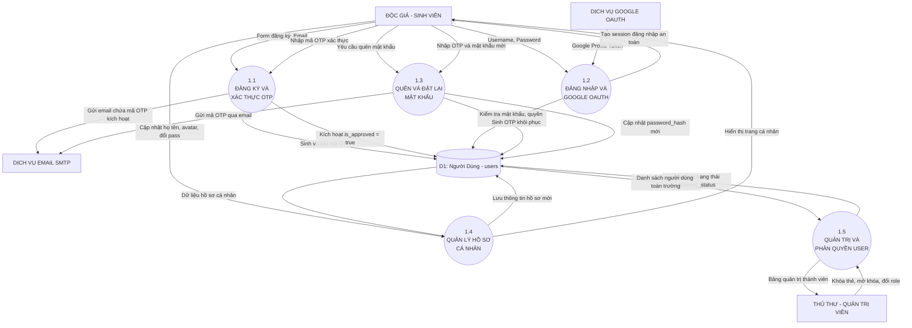

| Mã | Tên Tiến Trình Con | Dữ Liệu Đầu Vào (Input) | Dữ Liệu Đầu Ra (Output) | Kho Dữ Liệu |
|:---:|---|---|---|:---:|
| **1.1** | **Đăng ký & Xác thực OTP** | Họ tên, email, mật khẩu, mã xác thực OTP | Email kích hoạt gửi qua SMTP, cờ `is_approved = 1` | `D1 (users)` |
| **1.2** | **Đăng nhập & Google OAuth** | Tên đăng nhập, mật khẩu HOẶC Token Google SSO | Phiên làm việc (Session ID), quyền hạn, thông báo đăng nhập | `D1 (users)` |
| **1.3** | **Quên & Đặt lại mật khẩu** | Email yêu cầu, mã OTP xác thực, mật khẩu mới | Email chứa OTP khôi phục, mã hash mật khẩu mới | `D1 (users)` |
| **1.4** | **Quản lý hồ sơ cá nhân** | Thông tin chỉnh sửa (họ tên, ảnh đại diện, đổi mật khẩu) | Dữ liệu cá nhân cập nhật, thông tin thẻ thư viện hiển thị | `D1 (users)` |
| **1.5** | **Quản trị & Phân quyền** | Lệnh phân vai trò (Role), lệnh khóa thẻ / mở khóa thẻ | Trạng thái thẻ (`account_status`, `locked_until`), danh sách User | `D1 (users)` |

---

### 3.2 Phân Hệ 2.0: Quản Lý Kho Sách & Tra Cứu

Quản lý toàn bộ vòng đời ấn phẩm sách: từ tìm kiếm đa tiêu chí, đọc thử trực tuyến tài liệu PDF, quản lý danh mục phân loại đến nhập hàng loạt qua Excel.

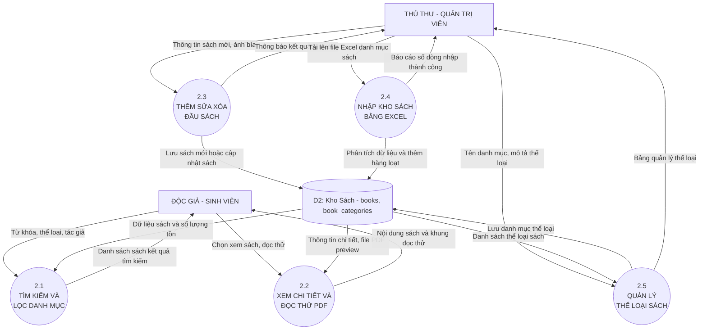

| Mã | Tên Tiến Trình Con | Dữ Liệu Đầu Vào (Input) | Dữ Liệu Đầu Ra (Output) | Kho Dữ Liệu |
|:---:|---|---|---|:---:|
| **2.1** | **Tìm kiếm & Lọc danh mục** | Từ khóa tìm kiếm, bộ lọc thể loại, tác giả, năm | Danh sách ấn phẩm khớp điều kiện, trạng thái còn/hết | `D2 (books)` |
| **2.2** | **Xem chi tiết & Đọc thử PDF** | Yêu cầu xem chi tiết, yêu cầu đọc thử | Metadata sách, file PDF preview kèm watermark bảo mật | `D2 (books)` |
| **2.3** | **Thêm, Sửa, Xóa đầu sách** | Form nhập liệu sách, ảnh bìa upload, file đọc thử | Bản ghi sách mới, thông báo trạng thái cập nhật | `D2 (books)` |
| **2.4** | **Nhập kho sách bằng Excel** | File bảng tính Excel `.xlsx`/`.csv` chứa nhiều đầu sách | Hàng loạt sách chèn vào kho, báo cáo thống kê dòng lỗi/thành công | `D2 (books)` |
| **2.5** | **Quản lý thể loại sách** | Tên thể loại mới, danh mục cha, mô tả thể loại | Cây danh mục thể loại cập nhật trên toàn hệ thống | `D2 (categories)` |

---

### 3.3 Phân Hệ 3.0: Quản Lý Lưu Thông Mượn - Trả Sách

Nghiệp vụ cốt lõi điều tiết việc luân chuyển sách vật lý, kiểm tra hạn mức mượn, phê duyệt, gia hạn thời gian và tự động xử lý vi phạm trễ hạn.

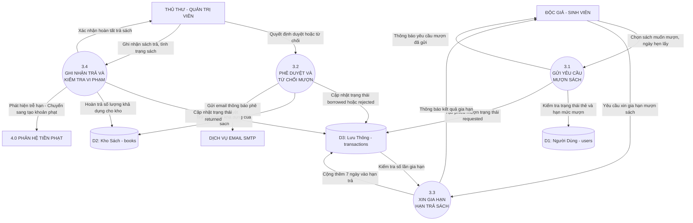

| Mã | Tên Tiến Trình Con | Dữ Liệu Đầu Vào (Input) | Dữ Liệu Đầu Ra (Output) | Kho Dữ Liệu |
|:---:|---|---|---|:---:|
| **3.1** | **Gửi yêu cầu mượn sách** | Sách chọn mượn, ngày hẹn nhận sách | Phiếu mượn trạng thái `requested`, kiểm tra hạn mức thẻ | `D1 (users)`, `D3 (trans)` |
| **3.2** | **Phê duyệt & Từ chối mượn** | Quyết định duyệt / từ chối của thủ thư kèm ghi chú | Phiếu mượn `borrowed`/`rejected`, trừ `available_qty`, email xác nhận | `D2 (books)`, `D3 (trans)` |
| **3.3** | **Xin gia hạn hạn trả sách** | Yêu cầu xin gia hạn từ độc giả | Kiểm tra số lần gia hạn (≤ 1), cộng thêm 7 ngày vào `due_date` | `D3 (transactions)` |
| **3.4** | **Ghi nhận trả & Kiểm tra vi phạm** | Sách trả thực tế, kiểm định tình trạng sách | Phiếu mượn `returned`, cộng lại kho sách, chuyển vi phạm sang phân hệ 4.0 | `D2 (books)`, `D3 (trans)`, 4.0 |

---

### 3.4 Phân Hệ 4.0: Quản Lý Tiền Phạt & Nộp Phạt VietQR Tự Động

Ứng dụng công nghệ FinTech hiện đại: Sinh mã VietQR động chuẩn Napas247, tự động lắng nghe biến động số dư qua Gmail Polling và gạch nợ tức thời (Atomic Update), tự động mở khóa thẻ.

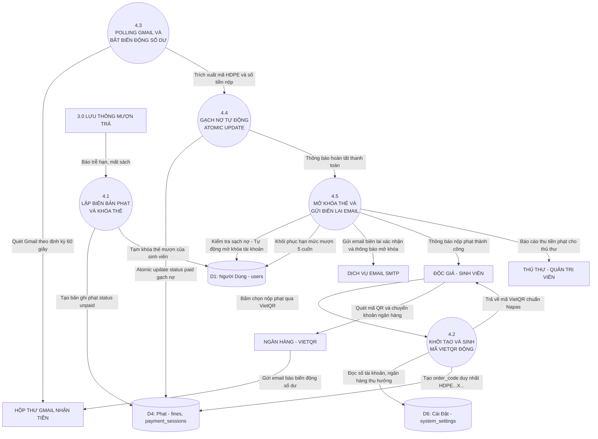

| Mã | Tên Tiến Trình Con | Dữ Liệu Đầu Vào (Input) | Dữ Liệu Đầu Ra (Output) | Kho Dữ Liệu |
|:---:|---|---|---|:---:|
| **4.1** | **Lập biên bản phạt & Khóa thẻ** | Số ngày quá hạn từ 3.4 (`days_overdue * 5,000 VNĐ`) | Bản ghi phạt `unpaid`, tài khoản bị tạm khóa (`locked`) | `D1 (users)`, `D4 (fines)` |
| **4.2** | **Khởi tạo & Sinh VietQR động** | Yêu cầu thanh toán của sinh viên | Mã định danh duy nhất `HDPE{id}X{hex}`, ảnh QR chứa số tiền chính xác | `D4 (fines)`, `D6 (settings)` |
| **4.3** | **Polling Gmail & Bắt số dư** | Cronjob chạy nền định kỳ quét email ngân hàng | Trích xuất mã giao dịch `HDPE`, số tiền thực nhận, thời gian nộp | Hộp thư Gmail Ngân Hàng |
| **4.4** | **Gạch nợ Atomic Update** | Mã đơn phạt và số tiền khớp chính xác | Bản ghi phạt cập nhật `paid`, lưu `paid_at`, đảm bảo Idempotency | `D4 (fines, payments)` |
| **4.5** | **Mở khóa thẻ & Gửi biên lai** | Tín hiệu gạch nợ thành công | Thẻ chuyển `active`, khôi phục hạn mức 5 cuốn, email biên lai điện tử | `D1 (users)`, `SMTP Mailer` |

---

### 3.5 Phân Hệ 5.0: Trợ Lý AI, Bảng Tin & Hỗ Trợ Ticket

Tích hợp trí tuệ nhân tạo thế hệ mới (Google Gemini API) và các kênh tương tác hai chiều giữa bạn đọc và ban quản lý thư viện.

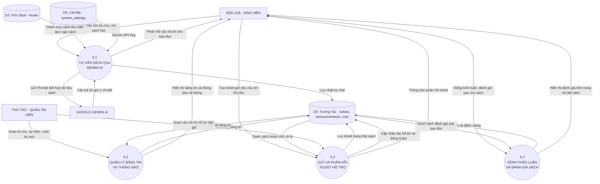

| Mã | Tên Tiến Trình Con | Dữ Liệu Đầu Vào (Input) | Dữ Liệu Đầu Ra (Output) | Kho Dữ Liệu |
|:---:|---|---|---|:---:|
| **5.1** | **Tư vấn sách qua Gemini AI** | Câu hỏi ngôn ngữ tự nhiên từ bạn đọc | Prompt RAG kết hợp danh mục sách, câu trả lời gợi ý thông minh | `D2 (books)`, `D5 (chat)`, `D6` |
| **5.2** | **Quản lý bảng tin & Thông báo** | Tin tức, sự kiện, thông báo lịch phục vụ từ Admin | Bài viết bảng tin, banner thông báo nổi bật trên trang chủ | `D5 (announcements)` |
| **5.3** | **Gửi & Phản hồi Ticket** | Yêu cầu trợ giúp từ độc giả; câu trả lời từ thủ thư | Ticket `open` → `in_progress` → `resolved`, trao đổi tin nhắn | `D5 (support_tickets)` |
| **5.4** | **Kênh thảo luận & Đánh giá** | Điểm số đánh giá (1-5★), bình luận nhận xét ấn bản | Điểm xếp hạng trung bình của sách, danh sách cảm nhận độc giả | `D5 (ratings, reviews)` |

---

## 4. Sơ Đồ Luồng Dữ Liệu DFD Mức 2 (Level 2 DFD) — Phân Rã Chi Tiết Tiến Trình Trọng Yếu

DFD Mức 2 đi sâu vào logic xử lý, kiểm tra điều kiện nghiệp vụ và các bước trung gian của các tiến trình hạt nhân phức tạp nhất trong toàn bộ hệ thống.

---

### 4.1 Quy Trình 3.1 & 3.2: Tiếp Nhận & Phê Duyệt Mượn Sách

Mô tả thuật toán kiểm tra 3 lớp (Trạng thái thẻ → Hạn mức mượn → Tồn kho khả dụng) trước khi cấp phát quyền mượn sách.

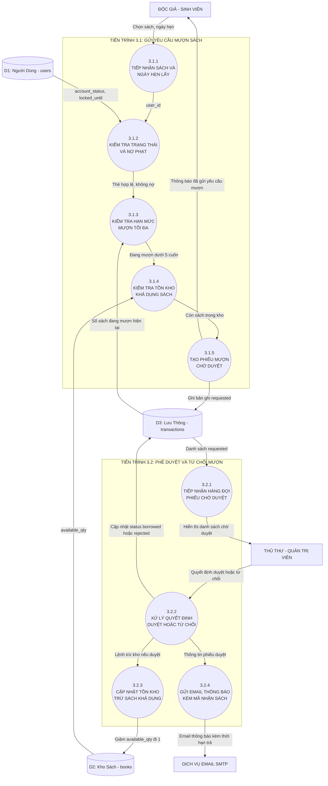

| Mã | Tên Bước Xử Lý | Điều Kiện / Logic Thuật Toán | Dữ Liệu Vào | Dữ Liệu Ra | Kho Dữ Liệu |
|:---:|---|---|---|---|:---:|
| **3.1.1** | **Tiếp nhận sách & ngày hẹn** | Độc giả bấm mượn từ giao diện chi tiết ấn phẩm | book_id, user_id, pickup_date | Request Payload | - |
| **3.1.2** | **Kiểm tra trạng thái thẻ** | `account_status == 'active' && (locked_until == NULL || locked_until < NOW())` | user_id | Đạt điều kiện / Bị chặn | `D1 (users)` |
| **3.1.3** | **Kiểm tra hạn mức mượn** | `COUNT(borrowed_books) < borrow_limit` (mặc định 5 cuốn) | user_id | Cho phép / Quá số lượng | `D3 (trans)` |
| **3.1.4** | **Kiểm tra tồn kho khả dụng** | `books.available_qty > 0` | book_id | Còn sách / Tạm hết | `D2 (books)` |
| **3.1.5** | **Tạo phiếu mượn chờ duyệt** | Ghi nhận đơn mượn với status = `'requested'`, borrow_date = ngày hẹn | Dữ liệu mượn | Transaction `requested` | `D3 (trans)` |
| **3.2.1** | **Tiếp nhận hàng đợi duyệt** | Lọc danh sách `status = 'requested' ORDER BY created_at ASC` | Bộ lọc thủ thư | Hàng đợi mượn | `D3 (trans)` |
| **3.2.2** | **Xử lý phê duyệt / từ chối** | Duyệt: `borrowed`, due_date = borrow_date + 14 ngày. Từ chối: `rejected` | Quyết định thủ thư | Cập nhật status | `D3 (trans)` |
| **3.2.3** | **Cập nhật tồn kho trừ sách** | Kích hoạt khi duyệt: `available_qty = available_qty - 1` | book_id | Giảm tồn kho khả dụng | `D2 (books)` |
| **3.2.4** | **Gửi email thông báo** | Soạn email HTML chứa tên sách, ngày nhận, hạn trả kèm Barcode | Thông tin phiếu duyệt | Email gửi qua SMTP | Mailer SMTP |

---

### 4.2 Quy Trình 3.4: Ghi Nhận Trả Sách & Xử Lý Vi Phạm

Giám định tính toàn vẹn của sách và thuật toán phát hiện trễ hạn, tự động chuyển hồ sơ vi phạm sang hệ thống xử phạt.

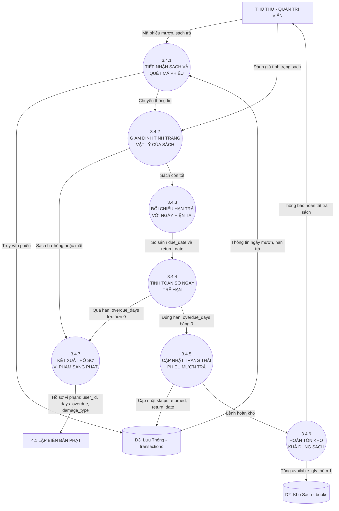

| Mã | Tên Bước Xử Lý | Điều Kiện / Logic Thuật Toán | Dữ Liệu Vào | Dữ Liệu Ra | Kho Dữ Liệu |
|:---:|---|---|---|---|:---:|
| **3.4.1** | **Tiếp nhận & quét mã** | Quét mã Barcode sách hoặc nhập transaction_id trên quầy lưu thông | transaction_id, barcode | Bản ghi phiếu mượn | `D3 (trans)` |
| **3.4.2** | **Giám định tình trạng vật lý** | Thủ thư kiểm tra: Nguyên vẹn / Rách nát / Mất trang / Thất lạc | Cuốn sách thực tế | Trạng thái hiện vật | - |
| **3.4.3** | **Đối chiếu hạn trả** | Đo hiệu số thời gian: `DATEDIFF(CURRENT_DATE, due_date)` | due_date, return_date | Số ngày chênh lệch | `D3 (trans)` |
| **3.4.4** | **Tính toán số ngày trễ** | `overdue_days = MAX(0, DATEDIFF(return_date, due_date))` | Số ngày chênh lệch | overdue_days | - |
| **3.4.5** | **Cập nhật phiếu mượn** | `status = 'returned', return_date = NOW(), returned_by = admin_id` | Dữ liệu trả sách | Bản ghi hoàn tất trả | `D3 (trans)` |
| **3.4.6** | **Hoàn kho khả dụng** | Nếu sách còn tốt: `available_qty = available_qty + 1` | book_id | Tăng tồn kho khả dụng | `D2 (books)` |
| **3.4.7** | **Kết xuất hồ sơ phạt** | Kích hoạt nếu overdue_days > 0 hoặc sách hỏng/mất | user_id, overdue_days | Chuyển dữ liệu sang 4.1 | Phân hệ 4.0 |

---

### 4.3 Quy Trình 4.2 - 4.4: FinTech VietQR, Gmail Polling & Gạch Nợ Tự Động

Chu trình khép kín không cần can thiệp thủ công: Sinh mã Napas247 động → Người dùng quét mã → Bắt biến động số dư qua Gmail API → Atomic Update gạch nợ tức thì → Tự động mở khóa thẻ.

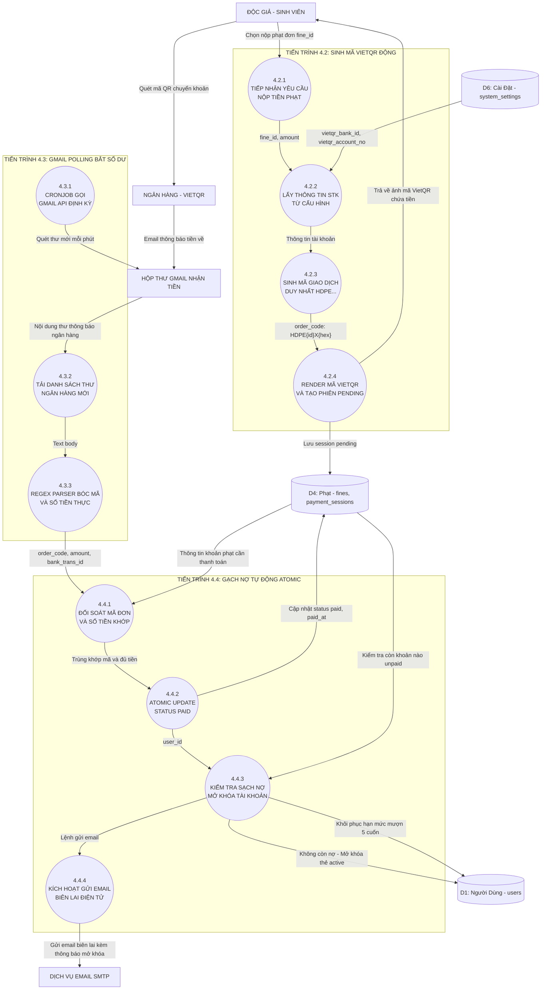

| Mã | Tên Bước Xử Lý | Điều Kiện / Logic Thuật Toán | Dữ Liệu Vào | Dữ Liệu Ra | Kho Dữ Liệu |
|:---:|---|---|---|---|:---:|
| **4.2.1** | **Tiếp nhận yêu cầu nộp phạt** | Sinh viên chọn khoản phạt cần thanh toán | fine_id, user_id | Request nộp tiền | `D4 (fines)` |
| **4.2.2** | **Lấy cấu hình ngân hàng** | Đọc tham số ngân hàng nhận tiền từ cấu hình hệ thống | - | vietqr_bank_id, vietqr_account_no | `D6 (settings)` |
| **4.2.3** | **Sinh mã giao dịch duy nhất** | Format: `"HDPE" . $fineId . "X" . substr(bin2hex(random_bytes(4)), 0, 6)` | fine_id | order_code độc nhất | - |
| **4.2.4** | **Render VietQR & tạo phiên** | Render QR Napas247, lưu bản ghi `payment_sessions` status = `pending` | order_code, amount | Ảnh QR Code | `D4 (sessions)` |
| **4.3.1** | **Cronjob Gmail Polling** | CLI worker chạy mỗi 60s, kết nối Google Gmail API qua OAuth2 | Google API Credentials | Phiên kết nối Gmail | Google API |
| **4.3.2** | **Tải email ngân hàng mới** | Query: `from:alert@nganhang.vn is:unread` | Query filter | Danh sách email GD mới | Hộp thư Gmail |
| **4.3.3** | **Regex Parser nội dung** | Pattern: `/HDPE(\d+)X([a-zA-Z0-9]{4,8})/i` và số tiền thực nhận | Nội dung thư | parsed_order_code, amount | - |
| **4.4.1** | **Đối soát mã đơn & số tiền** | Kiểm tra session tồn tại và `received_amount >= fine.amount` | parsed_order_code, amount | Kết quả khớp hợp lệ | `D4 (sessions)` |
| **4.4.2** | **Atomic Update gạch nợ** | `UPDATE fines SET status='paid', paid_at=NOW() WHERE fine_id=?` | fine_id, trans_id | Gạch nợ thành công | `D4 (fines)` |
| **4.4.3** | **Tự động mở khóa thẻ** | Nếu sạch nợ: `UPDATE users SET account_status='active', locked_until=NULL` | user_id | Thẻ khôi phục hoạt động | `D1 (users)` |
| **4.4.4** | **Gửi email biên lai** | Soạn biên lai điện tử gửi email xác nhận đã nộp phạt thành công | Biên lai thanh toán | Email gửi qua SMTP | Mailer SMTP |

---

### 4.4 Quy Trình 5.1: Trợ Lý AI Gemini & Context Injection (RAG)

Quy trình tăng cường ngữ cảnh (Lightweight RAG): Truy vấn top 15 đầu sách thư viện liên quan → Nhúng vào System Prompt → Gọi Google Gemini Flash → Trả lời kèm liên kết mượn trực tiếp.

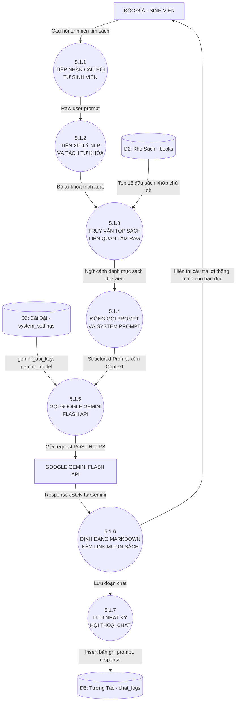

| Mã | Tên Bước Xử Lý | Điều Kiện / Logic Thuật Toán | Dữ Liệu Vào | Dữ Liệu Ra | Kho Dữ Liệu |
|:---:|---|---|---|---|:---:|
| **5.1.1** | **Tiếp nhận câu hỏi** | Người dùng nhập câu hỏi tra cứu bằng tiếng Việt tự nhiên | user_message | Raw Prompt | - |
| **5.1.2** | **Tiền xử lý NLP** | Chuẩn hóa Unicode, loại bỏ stop words, trích xuất cụm danh từ khóa | Raw Prompt | Mảng Keywords | - |
| **5.1.3** | **Truy vấn top sách RAG** | `SELECT * FROM books WHERE MATCH(...) OR title LIKE %key% LIMIT 15` | Mảng Keywords | 15 Metadata sách | `D2 (books)` |
| **5.1.4** | **Đóng gói Prompt RAG** | Ghép System Prompt (vai trò thủ thư) + Context 15 sách + User Prompt | Metadata + Prompt | Payload hoàn chỉnh | - |
| **5.1.5** | **Gọi Gemini Flash API** | Gửi Request POST HTTPS đến Endpoint Google Gemini Flash | Payload, API Key | JSON Response | `D6 (settings)` |
| **5.1.6** | **Định dạng Markdown** | Parse câu trả lời, gắn link xem chi tiết và nút mượn sách trực tiếp | JSON Response | HTML hiển thị | - |
| **5.1.7** | **Lưu nhật ký chat** | Ghi lại lịch sử đối thoại phục vụ phân tích nhu cầu đọc | user_id, prompt, response | Bản ghi chat | `D5 (chat_logs)` |

---

### 4.5 Quy Trình 2.4: Nhập Kho Sách Bằng File Excel Hàng Loạt

Quy trình nhập dữ liệu khối lượng lớn (Bulk Data Ingestion) qua file Excel/CSV kèm xác thực ma trận dữ liệu và chia lô (Batch Processing).

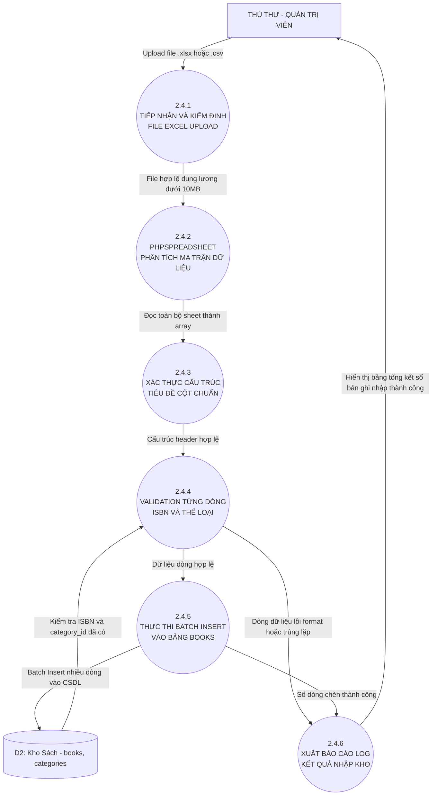

| Mã | Tên Bước Xử Lý | Điều Kiện / Logic Thuật Toán | Dữ Liệu Vào | Dữ Liệu Ra | Kho Dữ Liệu |
|:---:|---|---|---|---|:---:|
| **2.4.1** | **Tiếp nhận & kiểm định file** | File extension in `[xlsx, csv, xls]` và dung lượng `< 10MB` | `$_FILES['excel_file']` | File temp an toàn | - |
| **2.4.2** | **PhpSpreadsheet Reader** | Nạp IOFactory reader, phân tích sheet thành ma trận mảng 2 chiều | Đường dẫn file temp | Array rows dữ liệu | - |
| **2.4.3** | **Xác thực tiêu đề cột** | Kiểm tra hàng 1 chứa đúng: Title, Author, ISBN, Category, Quantity | Hàng 1 | Header hợp lệ | - |
| **2.4.4** | **Validation từng dòng** | Kiểm tra: ISBN không rỗng, Category tồn tại trong CSDL, Quantity ≥ 1 | Từng hàng dữ liệu | Dòng hợp lệ / lỗi | `D2 (categories)` |
| **2.4.5** | **Batch Insert vào CSDL** | Chia chunk 100 bản ghi/lần, thực thi Multi-row Insert tối ưu I/O | Mảng dòng hợp lệ | Hàng trăm sách nạp CSDL | `D2 (books)` |
| **2.4.6** | **Xuất báo cáo log kết quả** | Tổng hợp số bản ghi thành công, danh sách dòng lỗi format/trùng ISBN | Kết quả thực thi | Báo cáo chi tiết | - |

---

## 5. Sơ Đồ Luồng Dữ Liệu DFD Mức 3 (Level 3 DFD — Primitive Process Level)

DFD Mức 3 đại diện cho mức phân rã sâu nhất theo phương pháp luận Yourdon-DeMarco & Gane-Sarson. Tại mức độ này, các tiến trình con phức tạp nhất được phân giải thành các **tiến trình nguyên thủy (Primitive Processes)** gắn liền với **giải thuật vi mô (Micro-algorithms), cơ chế khóa dữ liệu (Pessimistic Locking & Idempotency), biểu thức chính quy (Regex Tokenizer), kỹ thuật Prompt RAG và tối ưu bộ nhớ I/O**.

---

### 5.1 Quy Trình 4.4.2: Gạch Nợ Atomic & Khóa Chống Double-Crediting

Mô hình hóa chi tiết cấp độ giao dịch ACID trong MySQL InnoDB: Sử dụng cơ chế khóa hàng `SELECT ... FOR UPDATE` (Pessimistic Locking), thẩm định tính lũy đẳng (Idempotency Check) nhằm ngăn chặn hiện tượng gạch nợ hai lần khi webhook hoặc email ngân hàng gửi lặp.

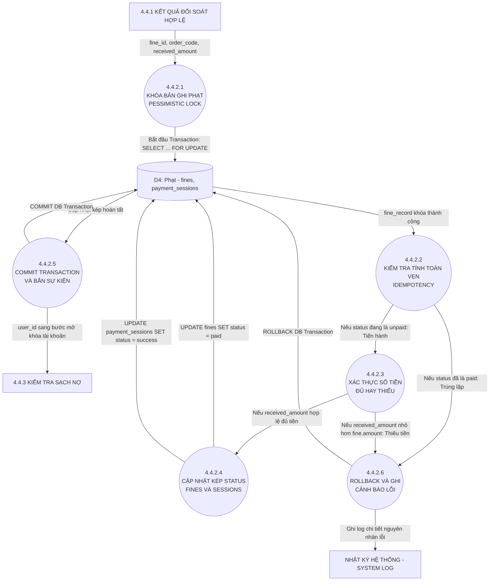

| Mã | Tên Bước Vi Mô | Logic Cấp Mã Lệnh / SQL | Dữ Liệu Vào | Dữ Liệu Ra | Xử Lý Ngoại Lệ / Rollback |
|:---:|---|---|---|---|---|
| **4.4.2.1** | **Khóa Pessimistic Lock** | `$db->beginTransaction(); SELECT * FROM fines WHERE id = ? FOR UPDATE;` | fine_id | Row lock độc quyền InnoDB | Deadlock Timeout sau 5s nếu bị tranh chấp |
| **4.4.2.2** | **Kiểm tra Idempotency** | `if ($fine['status'] === 'paid') return DuplicateIgnored;` | fine.status | Trạng thái chưa gạch nợ | Rollback và thoát, không xử lý lặp giao dịch |
| **4.4.2.3** | **Xác thực đối soát số tiền** | `if ((float)$receivedAmount < (float)$fine['amount']) throw UnderpaidException;` | received_amount, fine.amount | Xác nhận tiền đủ 100% | Ghi log cảnh báo thiếu tiền, Rollback |
| **4.4.2.4** | **Thực thi cập nhật kép** | `UPDATE fines SET status='paid', paid_at=NOW(); UPDATE payment_sessions SET status='success';` | fine_id, order_code | Số hàng ảnh hưởng: 2 rows | Rollback toàn bộ nếu 1 trong 2 câu lệnh lỗi |
| **4.4.2.5** | **Commit & Dispatch Event** | `$db->commit(); $eventManager->trigger('payment.success', $this, ['user_id' => $uid]);` | fine_id, user_id | Event kích hoạt mở khóa tài khoản | Log queue nếu Listener gặp trục trặc |
| **4.4.2.6** | **Rollback & Logging** | `$db->rollBack(); $logger->critical("Payment failed: " . $e->getMessage());` | Exception error trace | Bản ghi log hệ thống trong /data/logs | Trả về mã lỗi HTTP 500 hoặc Webhook Nack |

---

### 5.2 Quy Trình 4.3.3: Regex Tokenizer & Bóc Tách Thư Ngân Hàng Tự Động

Mô hình hóa chuỗi giải mã Base64 URL, loại bỏ các thẻ HTML trang trí, trích xuất biểu thức quy chuẩn (Regular Expressions) để bóc tách chính xác mã đơn hàng và số tiền giao dịch từ nội dung email ngân hàng.

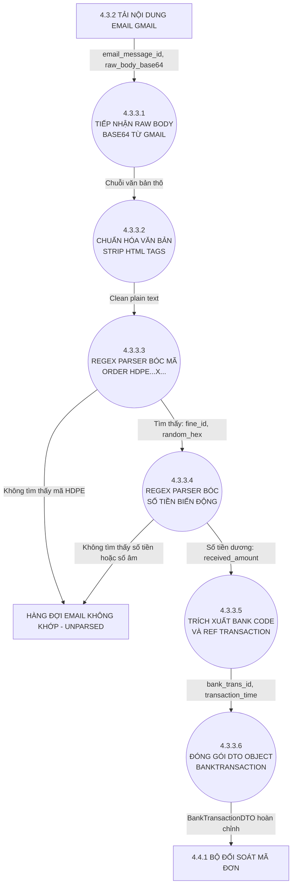

| Mã | Tên Bước Vi Mô | Biểu Thức Quy Chuẩn / Thuật Toán Regex | Dữ Liệu Vào | Dữ Liệu Ra | Xử Lý Ngoại Lệ / Fallback |
|:---:|---|---|---|---|---|
| **4.3.3.1** | **Base64 URL Decode** | `$decoded = base64_decode(strtr($rawBody, '-_', '+/'));` | raw_body_base64 | Raw HTML email string | Báo lỗi mã hóa UTF-8 nếu hỏng Base64 |
| **4.3.3.2** | **Làm sạch thẻ HTML** | `$cleanText = strip_tags(html_entity_decode($decoded));` | Raw HTML | Plain text thuần túy không chứa thẻ | Loại bỏ ký tự khoảng trắng không ngắt (NBSP) |
| **4.3.3.3** | **Bóc tách mã đơn HDPE** | `preg_match('/HDPE(?<fineId>\d+)X(?<hex>[a-fA-F0-9]{4,8})/i', $text, $matches)` | Clean text | order_code, fine_id | Đẩy vào unparsed queue nếu email không phải thanh toán thư viện |
| **4.3.3.4** | **Bóc tách số tiền chuyển** | `preg_match('/(\+|\b)(?<amount>[0-9]{1,3}([,.][0-9]{3})*)\s*(VND|đ|d)/ui', $text, $m)` | Clean text | Float amount (chuẩn hóa bỏ dấu phẩy) | Bỏ qua nếu là biến động trừ tiền (giao dịch đi) |
| **4.3.3.5** | **Trích xuất mã FT ngân hàng** | `preg_match('/(FT|GD|Ref)[\s:]*(?<ref>[A-Za-z0-9.]+)/i', $text, $refMatches)` | Clean text | bank_trans_id, trans_time | Sinh mã SHA256 thay thế nếu ngân hàng không gửi FT code |
| **4.3.3.6** | **Khởi tạo DTO đối soát** | `new BankTransactionDTO($orderCode, $amount, $bankRef, $transTime)` | Dữ liệu đã trích xuất | Đối tượng DTO hoàn chỉnh | Chuyển trực tiếp sang phân hệ 4.4.1 |

---

### 5.3 Quy Trình 5.1.4 - 5.1.5: Prompt Engineering RAG & Cơ Chế Local Fallback

Mô hình hóa chi tiết khâu nén ngữ cảnh (Context Compression) 15 đầu sách thư viện, nhúng vai trò System Instruction chuẩn sư phạm, cấu hình kết nối cURL HTTPS với Timeout và cơ chế cứu sinh (Fallback) trả lời ngoại tuyến khi quá hạn hoặc mất kết nối Google API.

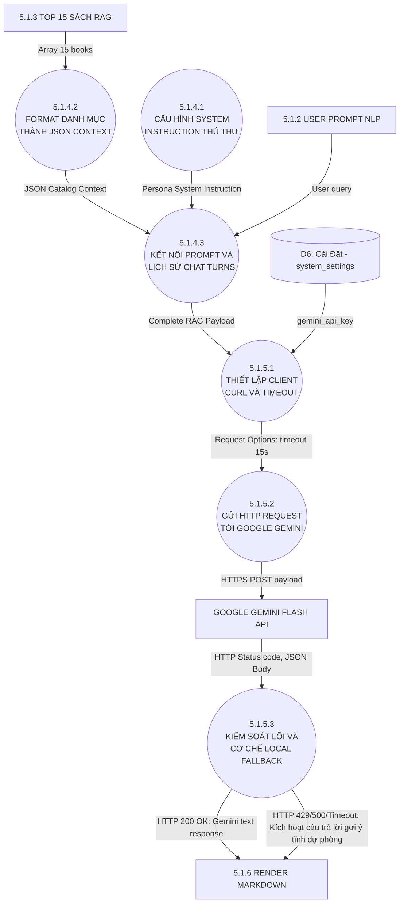

| Mã | Tên Bước Vi Mô | Logic Cấp Mã Lệnh & Cấu Trúc Payload | Dữ Liệu Vào | Dữ Liệu Ra | Xử Lý Ngoại Lệ / Fallback |
|:---:|---|---|---|---|---|
| **5.1.4.1** | **System Instruction Setup** | Định nghĩa role: 'systemInstruction' => {'parts': [{'text': 'Bạn là Thủ thư AI Thư viện HDPE...'}]} | System configuration | System Instruction Object | Nạp mặc định tiếng Việt chuẩn sư phạm |
| **5.1.4.2** | **Context Compression** | Rút gọn: `$context = array_map(fn($b) => ['id'=>$b->id, 't'=>$b->title, 'a'=>$b->author], $top15);` | 15 rows books | Minified JSON string (< 2KB) | Cắt giảm mô tả dài để tiết kiệm Token input |
| **5.1.4.3** | **Payload Assembly** | Tạo mảng: `['contents' => [['role' => 'user', 'parts' => [['text' => "Catalog: $context\nUser: $q"]]]]]` | User prompt + Context | Combined JSON payload | Sanitize loại bỏ ký tự điều khiển UTF-8 |
| **5.1.5.1** | **cURL Socket Configuration** | `CURLOPT_TIMEOUT => 15, CURLOPT_SSL_VERIFYPEER => true, CURLOPT_HTTPHEADER => ['Content-Type: application/json']` | gemini_api_key | Ready cURL Handler | Báo lỗi nếu SSL Certificate máy chủ bị quá hạn |
| **5.1.5.2** | **Execute HTTPS Request** | `$response = curl_exec($ch); $httpCode = curl_getinfo($ch, CURLINFO_HTTP_CODE);` | HTTPS POST call | Raw JSON response text | Bắt lỗi cURL error code (CURLE_OPERATION_TIMEDOUT) |
| **5.1.5.3** | **Fallback Local Response** | Nếu `$httpCode != 200`: Sinh câu trả lời dựa trên danh sách 15 sách lấy từ CSDL kèm lời xin lỗi AI bận | HTTP status code | Fallback Text Markdown | Người dùng vẫn nhận được sách gợi ý 100% không bị trắng trang |

---

### 5.4 Quy Trình 1.1.2 - 1.1.3: Bảo Mật OTP, Rate Limiting & Hashing

Mô hình hóa kiến trúc sinh mã an toàn bằng bộ tạo số ngẫu nhiên mật mã (CSPRNG), cơ chế giới hạn tần suất cửa sổ trượt (Sliding Window Rate Limit), mã hóa băm Bcrypt lưu DB kèm thời hạn hết hạn 300 giây và giao vận TLS SMTP 587.

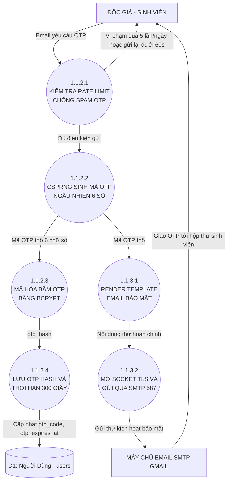

| Mã | Tên Bước Vi Mô | Logic Cấp Mã Lệnh & An Toàn Mật Mã | Dữ Liệu Vào | Dữ Liệu Ra | Cơ Chế Bảo Vệ & Giới Hạn |
|:---:|---|---|---|---|---|
| **1.1.2.1** | **Kiểm tra Rate Limit (Sliding Window)** | `if (time() - $lastSent < 60 || $dailyCount >= 5) throw RateLimitException;` | IP Address, Email | Chấp thuận / Từ chối (HTTP 429) | Chống brute-force và làm cạn kiệt hạn mức quota email |
| **1.1.2.2** | **CSPRNG Secure Generator** | `$otp = str_pad((string)random_int(100000, 999999), 6, '0', STR_PAD_LEFT);` | Entropy từ OS Kernel | Mã OTP 6 số ngẫu nhiên | Sử dụng CSPRNG chống dự đoán chuỗi số giả ngẫu nhiên |
| **1.1.2.3** | **Mật mã hóa Bcrypt Hash** | `$otpHash = password_hash($otp, PASSWORD_BCRYPT, ['cost' => 10]);` | Mã OTP thô | Chuỗi hash 60 ký tự an toàn | DB không bao giờ lưu plain text OTP tránh rò rỉ khi lộ database |
| **1.1.2.4** | **Lưu TTL 300 Giây** | `UPDATE users SET otp_code=?, otp_expires_at=DATE_ADD(NOW(), INTERVAL 5 MINUTE);` | otpHash, user_id | Bản ghi có thời hạn | Sau 5 phút mã tự động vô hiệu hóa |
| **1.1.3.1** | **Render HTML Email Template** | Nạp View ViewModel của Laminas, render giao diện Dark/Light thương hiệu HDPE | OTP thô, Họ tên độc giả | Mã HTML Email | Escape toàn bộ biến tránh XSS trong Email Client |
| **1.1.3.2** | **Giao thức TLS SMTP Transport** | `$transport = new SmtpTransport(new SmtpOptions(['connection_class' => 'login', 'port' => 587]));` | SMTP Credentials | Email gửi đi thành công | Tự động Retry 3 lần nếu mạng chập chờn |

---

### 5.5 Quy Trình 2.4.4 - 2.4.5: Checksum ISBN, Deduplication & Batch Chunks

Mô hình hóa thuật toán xác thực kiểm tra mã vạch quốc tế ISBN-13 bằng thuật toán Modulo 10, cấu trúc tập hợp khử trùng lặp trong bộ nhớ (In-memory Set Deduplication O(1)), gom khối (Chunking) 50 bản ghi/lần và kỹ thuật Multi-row Upsert kèm giải phóng bộ nhớ Garbage Collection.

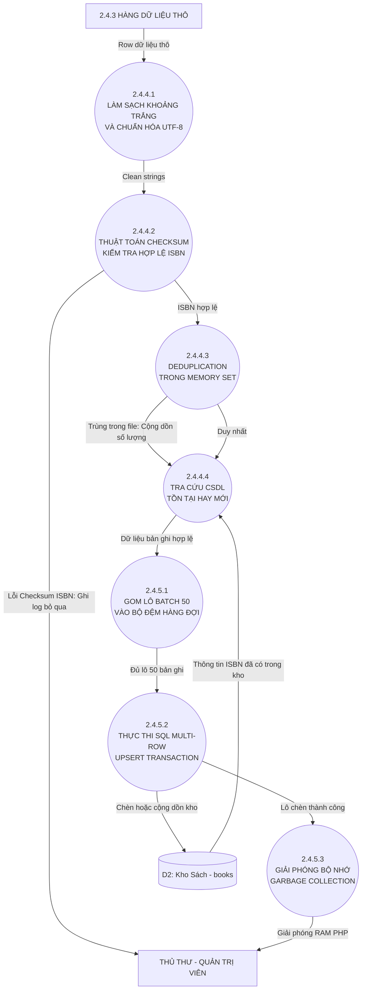

| Mã | Tên Bước Vi Mô | Thuật Toán Cấp Thấp & Kiểm Tra Tính Toàn Vẹn | Dữ Liệu Vào | Dữ Liệu Ra | Tối Ưu Hiệu Năng / Bộ Nhớ |
|:---:|---|---|---|---|---|
| **2.4.4.1** | **Sanitize & UTF-8 Normalization** | `$clean = mb_convert_encoding(trim((string)$cell), 'UTF-8', 'auto');` | Raw cell value | Sanitized string | Loại bỏ ký tự ẩn BOM (Byte Order Mark) gây lỗi câu lệnh SQL |
| **2.4.4.2** | **Thuật toán Checksum ISBN Modulo 10** | Tính tổng trọng số: `(d1*1 + d2*3 + d3*1 + ... + d12*3) % 10 == (10 - d13) % 10` | ISBN-13 string | Hợp lệ / Lỗi Checksum | Chặn ngay từ bộ nhớ các mã ISBN gõ sai trước khi đẩy vào CSDL |
| **2.4.4.3** | **In-Memory Deduplication Set** | `if (isset($memorySet[$isbn])) { $memorySet[$isbn]['qty'] += $qty; continue; }` | Clean ISBN | Deduplicated Record Map | Độ phức tạp O(1) tra cứu Hash Table, tránh trùng sách trong file Excel |
| **2.4.4.4** | **Database Existence Matcher** | `SELECT book_id, quantity FROM books WHERE isbn IN ($chunkIsbns);` | Mảng ISBN chunk | Map sách hiện có trong kho | Sử dụng câu lệnh `IN (...)` thay vì SELECT lặp 1 dòng/lần |
| **2.4.5.1** | **Chunk Queue Buffer** | Gom các bản ghi đạt chuẩn vào mảng đệm `$batchQueue[]` đạt 50 items | Records | Batch buffer 50 rows | Tránh tràn bộ nhớ (Memory Exhaustion) với file hàng chục nghìn dòng |
| **2.4.5.2** | **Multi-Row Upsert Transaction** | `INSERT INTO books (...) VALUES (...), (...) ON DUPLICATE KEY UPDATE quantity=quantity+VALUES(quantity);` | Batch 50 items | Thực thi DB 1 lần | Giảm 98% Round-trip network queries so với phương pháp INSERT đơn lẻ |
| **2.4.5.3** | **Garbage Collection Sweep** | `unset($rows, $batchQueue); gc_collect_cycles();` | RAM PHP Process | Bộ nhớ được giải phóng | Duy trì RAM PHP ổn định dưới 64MB cho toàn bộ phiên Import lớn |

---

## 6. Sơ Đồ Luồng Dữ Liệu DFD Mức 4 (Level 4 DFD — Atomic Process & Engine Specification)

DFD Mức 4 là mức phân rã hạt nhân nguyên tử (P-Spec / Mini-Spec) đi sâu vào tầng **Storage Engine MySQL (InnoDB Buffer Pool, B+Tree Next-Key Lock, Two-Phase Commit Redo/Undo Log), Máy trạng thái hữu hạn DFA/NFA Regex Engine, Tầng mạng TCP/TLS 1.3 Handshake & Socket Gemini, Khối mật mã CSPRNG/Eksblowfish Bcrypt và Giải thuật ALU Bitwise CPU Modulo 10**.

---

### 6.1 Quy Trình 4.4.2.1 - 4.4.2.4: Chu Kỳ Giao Dịch InnoDB, Khóa Next-Key & Two-Phase Commit

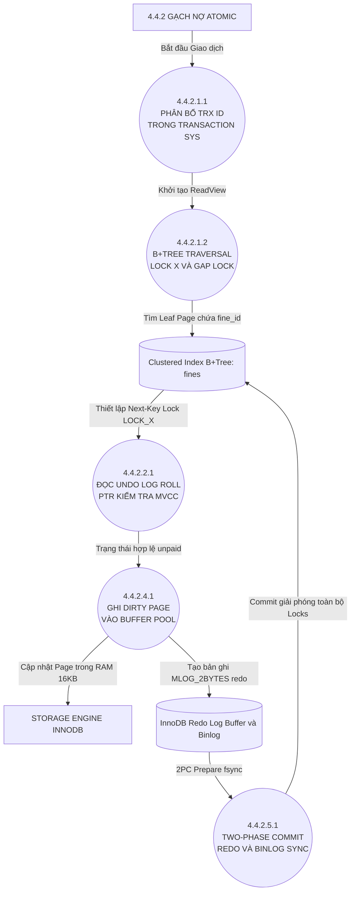

| Mã P-Spec | Tên Thao Tác Hạt Nhân | Cơ Chế Bộ Nhớ / Storage Engine Level | Khóa & Concurrency | IOPS & Disk Sync |
|:---:|---|---|---|---|
| **4.4.2.1.1** | **Trx ID Allocation** | Tăng biến đếm tuần tự nguyên tử `trx_sys->max_trx_id++` trong vùng nhớ MySQL | Không khóa bảng; cấp Transaction ID 64-bit độc nhất | In-memory RAM access |
| **4.4.2.1.2** | **B+Tree Next-Key Lock** | Duyệt từ Root Page đến Leaf Page của Primary Key Index `fines(id)` | Tạo `LOCK_REC_NOT_GAP \| LOCK_X`; chặn sửa/xóa dòng | Hit InnoDB Buffer Pool (LRU Cache) |
| **4.4.2.2.1** | **Undo Log MVCC Check** | Đọc trường ẩn `DB_ROLL_PTR` và `DB_TRX_ID` trỏ về Undo Segment | Repeatable Read Isolation đảm bảo thấy dữ liệu mới nhất | Truy xuất Undo Tablespace |
| **4.4.2.4.1** | **Dirty Page & Redo Buffer** | Sửa bit trang 16KB trong RAM, đánh dấu Dirty Page; ghi LSN vào Log Buffer | Vẫn duy trì khóa Exclusive Lock (X-Lock) | Chưa ghi Disk (Lazy Flush) |
| **4.4.2.5.1** | **Two-Phase Commit (2PC)** | B1: Ghi Redo Log Prepare; B2: Ghi Binary Log; B3: Commit Redo Log | Giải phóng Record Lock và Gap Lock trên B+Tree | `fsync()` xuống ổ đĩa vật lý (Durable ACID) |

---

### 6.2 Quy Trình 4.3.3.3 - 4.3.3.4: Máy Trạng Thái Hữu Hạn (DFA/NFA) & Bộ Quét Chuỗi Byte

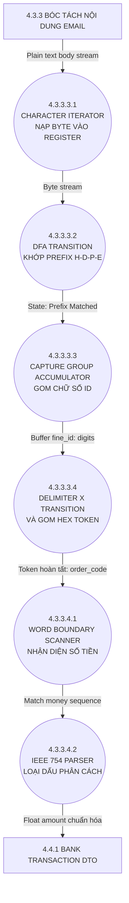

| Mã P-Spec | Trạng Thái DFA/NFA | Quy Tắc Chuyển Dịch (State Transition) | Bộ Đệm Ký Tự (Accumulator) | Độ Phức Tạp |
|:---:|---|---|---|:---:|
| **4.3.3.3.1** | **Byte Stream Pointer** | Con trỏ `*p` duyệt qua từng byte trong mảng ký tự văn bản thuần | Thanh ghi con trỏ bộ nhớ RAM (0-offset) | $O(N)$ |
| **4.3.3.3.2** | **Prefix Match DFA** | Chuyển dịch: `S0 -> 'H' -> S1 -> 'D' -> S2 -> 'P' -> S3 -> 'E' -> S4` | Reset về S0 nếu ký tự không khớp | $O(1)$ |
| **4.3.3.3.3** | **Group Capture: fineId** | Ở trạng thái S4, lặp chấp nhận `[0-9]`; chuyển sang S5 khi gặp `'X'` | Buffer `fineId[]` nạp ký tự số ASCII | Max 10 bytes |
| **4.3.3.3.4** | **Token Suffix: Hex** | Ở trạng thái S5, tích lũy từ 4 đến 8 ký tự trong tập `[0-9a-fA-F]` | Ghép chuỗi: `order_code = "HDPE" . $fineId . "X" . $hex` | Trạng thái Accept |
| **4.3.3.4.1** | **Word Boundary Check** | Nhận diện ranh giới từ `\b` hoặc dấu `'+'` biểu thị biến động dương | Kiểm tra ký tự liền trước không phải chữ/số | Ngăn nhầm STK/SĐT |
| **4.3.3.4.2** | **IEEE 754 Floating Parser** | Loại bỏ dấu phân cách `,` hoặc `.`; gọi `strtod()` chuyển sang số thực | Thanh ghi số thực 64-bit IEEE 754 double precision | $O(k)$ |

---

### 6.3 Quy Trình 5.1.5.1 - 5.1.5.2: Tầng Mạng TCP/TLS 1.3 Handshake & cURL Socket Gemini API

```mermaid
graph TB
    P515["5.1.5 GỌI GEMINI API"]
    P516["5.1.6 PARSE MARKDOWN RESPONSE"]
    E_DNS["DNS SERVER 8.8.8.8"]
    E_GOOGLE["GOOGLE EDGE POP"]

    P51511(("5.1.5.1.1<br/>DNS RESOLUTION UDP 53<br/>LẤY IPV4 HOST"))
    P51512(("5.1.5.1.2<br/>TCP 3-WAY HANDSHAKE<br/>SYN - SYN/ACK - ACK"))
    P51513(("5.1.5.1.3<br/>TLS 1.3 KEY SHARE<br/>ECDHE CURVE25519"))
    P51521(("5.1.5.2.1<br/>MÃ HÓA AES-256-GCM<br/>VÀ GỬI HTTP/2 FRAMES"))
    P51522(("5.1.5.2.2<br/>SOCKET TIMER 15S<br/>VÀ STREAM RECEIVER"))

    P515 -->|"URL: generativelanguage..."| P51511
    P51511 -->|"Gửi DNS Query"| E_DNS
    E_DNS -->|"IP: 142.250.x.x"| P51512
    P51512 -->|"TCP Handshake"| E_GOOGLE
    E_GOOGLE -->|"TCP Established"| P51513
    P51513 -->|"Cipher Suite Handshake"| E_GOOGLE
    E_GOOGLE -->|"TLS 1.3 Session Ready"| P51521
    P51521 -->|"Gửi Encrypted JSON Payload"| E_GOOGLE
    E_GOOGLE -->|"Nhận HTTPS Stream"| P51522
    P51522 -->|"Response JSON"| P516
```

| Mã P-Spec | Tầng Giao Thức (OSI Layer) | Gói Tin / Thao Tác Socket Cấp Thấp | Thời Gian Phản Hồi (RTT) | Bảo Mật & Tiêu Chuẩn Mạng |
|:---:|---|---|---|---|
| **5.1.5.1.1** | **Application / DNS** | Gửi gói UDP cổng 53 truy vấn bản ghi `A generativelanguage.googleapis.com` | ~5ms (DNS Cache) | Hỗ trợ DNSSEC chống Cache Poisoning |
| **5.1.5.1.2** | **Transport (TCP)** | Kernel gửi cờ `SYN`, nhận `SYN-ACK` từ Google Edge POP, gửi `ACK` | 1 RTT (~20ms) | TCP Window Size 64KB, TCP Fast Open |
| **5.1.5.1.3** | **Security (TLS 1.3)** | Trao đổi khóa Diffie-Hellman Elliptic Curve (ECDHE Curve25519) trong Client Hello | 1 RTT (giảm 50% trễ) | Perfect Forward Secrecy (PFS) |
| **5.1.5.2.1** | **HTTP/2 Encrypted** | Đóng khung HEADERS + DATA frame, mã hóa đối xứng `AES-256-GCM` | Streaming payload | HPACK nén Header; xác thực GMAC |
| **5.1.5.2.2** | **Socket Control** | Hàm `curl_multi_select()` theo dõi socket với bộ đếm Timeout 15.000ms | Timeout tại 15.000ms | Đóng Socket; rẽ nhánh Local Fallback |

---

### 6.4 Quy Trình 1.1.2.2 - 1.1.2.3: Bộ Sinh Entropy OS, CSPRNG & Thuật Toán Eksblowfish Bcrypt

```mermaid
graph TB
    P112["1.1.2 SINH MÃ OTP"]
    E_KERNEL["OS KERNEL ENTROPY POOL"]
    D1_USER[("D1: users - otp_code")]

    P11221(("1.1.2.2.1<br/>POLLING HARDWARE NOISE<br/>CRYPTGENRANDOM / URANDOM"))
    P11222(("1.1.2.2.2<br/>UNBIASED MAPPING<br/>INTERVAL 100000 - 999999"))
    P11231(("1.1.2.3.1<br/>SINH 128-BIT SALT<br/>VÀ MÃ HÓA RADIX-64"))
    P11232(("1.1.2.3.2<br/>EKSBLOWFISH SETUP<br/>P-ARRAY VÀ 4 S-BOXES"))
    P11233(("1.1.2.3.3<br/>KEY EXPANSION 1024 ROUNDS<br/>COST 10 CRYPTO LOOP"))
    P11234(("1.1.2.3.4<br/>MÃ HÓA MAGIC STRING<br/>XUẤT HASH 60 CHARS"))

    P112 -->|"Yêu cầu sinh OTP bảo mật"| P11221
    E_KERNEL -->|"Entropy raw bytes"| P11221
    P11221 -->|"32-bit random integer"| P11222
    P11222 -->|"Mã OTP 6 số nguyên"| P11231
    P11231 -->|"16 bytes salt"| P11232
    P11232 -->|"S-box khởi tạo"| P11233
    P11233 -->|"Khóa mở rộng sau 1024 vòng"| P11234
    P11234 -->|"Chuỗi Bcrypt $2y$10$..."| D1_USER
```

| Mã P-Spec | Bước Mật Mã Học | Thuật Toán Chi Tiết / Công Thức Toán Học | Dữ Liệu Khởi Tạo | Tiêu Chuẩn Chống Tấn Công |
|:---:|---|---|---|---|
| **1.1.2.2.1** | **Hardware Noise Polling** | Thu thập xung CPU Jitter, ngắt bàn phím qua Syscall `getrandom()` / Windows CNG | 32-bit Entropy | FIPS 140-2 chuẩn ngẫu nhiên thống kê |
| **1.1.2.2.2** | **Unbiased Range Scaling** | Lemire Rejection Sampling: Loại bỏ độ lệch modulo trong $[100000, 999999]$ | Khoảng $900.000$ giá trị | Xác suất mọi số đều bằng $1/900.000$ |
| **1.1.2.3.1** | **128-Bit Salt Gen** | Trích xuất 16 bytes ngẫu nhiên từ CSPRNG, mã hóa Radix-64 Base64 biến thể | 16 bytes ngẫu nhiên | Vô hiệu hóa Rainbow Table |
| **1.1.2.3.2** | **S-Box Initialization** | Khởi tạo mảng P-array 18 phần tử 32-bit và 4 hộp S-box 256 phần tử từ số $\pi$ hex | 4168 bytes bảng RAM | Kháng mã hóa vi sai |
| **1.1.2.3.3** | **Eksblowfish Key Expansion** | Thực hiện $2^{10} = 1024$ vòng lặp biến đổi khóa đan xen Salt và OTP string | Vòng lặp nặng CPU | Chống ASIC/GPU brute-force qua L1/L2 cache |
| **1.1.2.3.4** | **Ciphertext Output** | Mã hóa chuỗi `"OrpheanBeholderScryDoubt"` 64 lần, xuất băm 60 ký tự | `$2y$10$[salt22][hash31]` | Bcrypt chuỗi chuẩn hóa lưu bảng `users` |

---

### 6.5 Quy Trình 2.4.4.2: Vector Hóa Trọng Số ISBN-13 Modulo 10 & Phép Toán Bitwise CPU

```mermaid
graph TB
    P244["2.4.4 VALIDATE EXCEL ROW"]
    P245["2.4.5 BATCH INSERT BUFFER"]
    E_DISCARD["LOG BẢN GHI HỎNG CHECKSUM"]

    P24421(("2.4.4.2.1<br/>ASCII VALIDATOR<br/>CHECK RANGE 0x30 - 0x39"))
    P24422(("2.4.4.2.2<br/>VECTOR HÓA 12 SỐ ĐẦU<br/>ARRAY D1 ĐẾN D12"))
    P24423(("2.4.4.2.3<br/>BITWISE CPU WEIGHTING<br/>1 PLUS I AND 1 SHIFT 1"))
    P24424(("2.4.4.2.4<br/>TÍCH LŨY TỔNG S<br/>VÀ CHIA DƯ MODULO 10"))
    P24425(("2.4.4.2.5<br/>SO KHỚP BIT VỚI D13<br/>EQUALS CHECK CHAR"))

    P244 -->|"ISBN-13 raw string"| P24421
    P24421 -->|"Ký tự không phải số"| E_DISCARD
    P24421 -->|"13 chữ số ASCII hợp lệ"| P24422
    P24422 -->|"Vector [d1...d12]"| P24423
    P24423 -->|"Dãy tích số trọng số"| P24424
    P24424 -->|"Số kiểm tra Checksum tính toán"| P24425
    P24425 -->|"Không khớp: Checksum Fail"| E_DISCARD
    P24425 -->|"Khớp: ISBN-13 toàn vẹn"| P245
```

| Mã P-Spec | Thao Tác CPU / ALU | Chỉ Lệnh Máy & Mã Tối Ưu Bitwise | Dữ Liệu Thanh Ghi | Tối Ưu Chu Kỳ Xung Nhịp |
|:---:|---|---|---|---|
| **2.4.4.2.1** | **ASCII Range Validator** | Kiểm tra `(byte >= 0x30 && byte <= 0x39)` loại trừ ký tự rác | Thanh ghi AL / 8-bit char | 1 chu kỳ lệnh `cmp` + `jbe` |
| **2.4.4.2.2** | **Vector Cast 12 Digits** | Chuyển mã ASCII sang số nguyên: `val = byte - 0x30` | Mảng thanh ghi Vector SIMD | Thao tác trực tiếp CPU L1 cache |
| **2.4.4.2.3** | **Branchless Bitwise Weighting** | Tính trọng số không dùng `if/else`: `$w = 1 + (($i & 1) << 1);` | Lẻ = 1, Chẵn = 3 | Triệt tiêu Branch Misprediction |
| **2.4.4.2.4** | **Accumulated Modulo** | Tích lũy $S = \sum (d_i \times w_i)$; tính: `$rem = (10 - ($S % 10)) % 10;` | Thanh ghi số nguyên EAX | Lệnh nhân cộng `imul` + `idiv` |
| **2.4.4.2.5** | **Strict Comparator** | So sánh `$rem === (ord($isbn[12]) - 0x30)` | Cờ CPU Zero Flag (ZF = 1) | Độ trễ < 10 nanoseconds/cuốn |

---

## 7. Sơ Đồ Luồng Dữ Liệu DFD Mức 5 (Level 5 DFD — Hardware Execution & Silicon Architecture)

DFD Mức 5 đại diện cho mức phân rã sâu nhất trong khoa học máy tính: Tầng vật lý vi kiến trúc silicon (**Hardware / Silicon Architecture Level**). Tại đây, các luồng dữ liệu được ánh xạ tới **chu kỳ xung nhịp CPU, thanh ghi Vector AVX2 256-bit, vi kiến trúc Out-of-Order Execution, đường truyền L1/L2/L3 Cache & Bus DRAM DDR4/DDR5, bộ điều khiển lưu trữ NVMe PCIe Gen4 x4 DMA & lập trình ô nhớ 3D TLC NAND Flash, card mạng NIC Ring Buffer & ngắt MSI-X NAPI, và nguồn nhiễu nhiệt lượng tử bán dẫn RDRAND TRNG**.

---

### 7.1 Quy Trình 5.1 (4.4.2.5.1): Ghi Đĩa NVMe PCIe DMA, Submission Queue & Lập Trình NAND Flash Page

```mermaid
graph TB
    P4425["4.4.2.5 2PC COMMIT REDO"]
    E_CPU["CPU INSTRUCTION POINTER"]
    E_FLASH["NAND FLASH FLOATING GATES"]

    P511(("5.1.1<br/>MMIO DOORBELL WRITE<br/>NẠP THANH GHI NVME"))
    P512(("5.1.2<br/>PCIE GEN4 FETCH<br/>KÉO SUBMISSION QUEUE"))
    P513(("5.1.3<br/>BUS MASTER DMA<br/>RAM HOST SANG SSD BUFFER"))
    P514(("5.1.4<br/>FTL CHARGE TRAP<br/>ÁP ĐIỆN ÁP V_PGM"))
    P515_P(("5.1.5<br/>MSI-X INTERRUPT<br/>COMPLETION QUEUE CQ"))

    D_RAM[("Host RAM: 16KB Dirty Page")]
    D_SSD_DRAM[("SSD Controller SRAM Cache")]

    E_CPU -->|"Lệnh ghi fsync syscall"| P511
    P511 -->|"Ghi thanh ghi Doorbell qua PCIe"| P512
    P512 -->|"Kéo NVMe SQ Entry 64B"| D_RAM
    D_RAM -->|"DMA Burst Transfer 64 GT/s"| P513
    P513 -->|"Nạp khối dữ liệu 4KB"| D_SSD_DRAM
    D_SSD_DRAM -->|"Lập lịch FTL Wear Leveling"| P514
    P514 -->|"Bơm electron qua lớp oxit"| E_FLASH
    P514 -->|"Trạng thái Program Complete"| P515_P
    P515_P -->|"Bắn ngắt MSI-X Vector"| E_CPU
```

| Mã Bước | Cơ Chế Phần Cứng | Giao Thức Tín Hiệu & Thanh Ghi | Băng Thông / Độ Trễ Vật Lý | Mức Độ Toàn Vẹn ACID |
|:---:|---|---|---|---|
| **5.1.1** | **NVMe Doorbell MMIO** | Ghi giá trị Tail Pointer mới vào thanh ghi MMIO `SQ0TDBL` (Bar0 + 0x1000) | ~50 nanoseconds qua PCIe Root Complex | Kích hoạt vi điều khiển SSD nhận diện lệnh Write |
| **5.1.2** | **Submission Queue Fetch** | SSD ASIC đọc cấu trúc 64-byte SQE (Command Dword 0..15, PRP Entry, LBA address) | PCIe Gen4 x4: 64 Gbps (8 GB/s lý thuyết) | Đảm bảo thứ tự lệnh I/O tuần tự (In-order Execution) |
| **5.1.3** | **Bus Master DMA Transfer** | DMA Controller của SSD tự động đọc thẳng vùng nhớ `Redo Log Buffer` trên Host RAM | Tốc độ DMA ~6.5 GB/s thực tế; CPU 0% Overhead | Zero-copy từ nhân OS vào DRAM đệm của SSD |
| **5.1.4** | **NAND Flash Page Program** | Bơm điện áp $V_{pgm} \approx 18V - 20V$ đẩy electron vào bẫy điện tích (Charge Trap) TLC 3-bit | Thời gian lập trình ô nhớ ($t_{PROG}$) $\approx 500\mu s - 800\mu s$ | Bền vững vĩnh viễn (Non-volatile), chống mất điện |
| **5.1.5** | **MSI-X Interrupt & CQE** | Ghi 16-byte CQE vào Host CQ, bắn vector ngắt MSI-X tới APIC CPU đánh thức thread `fsync()` | Độ trễ ngắt ~1.5 microseconds | Giải phóng thread PHP tiếp tục phản hồi cho client |

---

### 7.2 Quy Trình 5.2 (4.3.3.3.1): Đường Truyền L1/L2/L3 Cache Line, D-TLB & Chu Kỳ DRAM Burst Bus

```mermaid
graph TB
    P4333["4.3.3.3 DTO STREAM SCANNER"]
    E_ALU["CPU GENERAL REGISTER RAX"]
    E_DRAM["DDR4 / DDR5 DRAM CHIP"]

    P521(("5.2.1<br/>MMU VIRTUAL ADDRESS<br/>L1 D-TLB TRANSLATION"))
    P522(("5.2.2<br/>L1 DATA CACHE TAG<br/>SO KHỚP 32KB 8-WAY"))
    P523(("5.2.3<br/>L2 VÀ L3 CACHE MISS<br/>PIPELINE BUS STALL"))
    P524(("5.2.4<br/>MEMORY CONTROLLER<br/>ACTIVATE VÀ READ COMMAND"))
    P525(("5.2.5<br/>BURST TRANSFER 64B<br/>LẤY TRỌN CACHE LINE"))

    D_L1[("CPU L1/L2 Cache Lines")]
    D_L3[("CPU Shared L3 Cache 32MB")]

    P4333 -->|"Đọc con trỏ chuỗi *p"| P521
    P521 -->|"Tra cứu Physical Address"| P522
    P522 -->|"L1 Cache Hit: 4 cycles"| E_ALU
    P522 -->|"L1 Cache Miss"| P523
    P523 -->|"Tra cứu L2/L3 Tags"| D_L3
    D_L3 -->|"L3 Miss: ~60 cycles"| P524
    P524 -->|"Phát lệnh qua Memory Bus"| E_DRAM
    E_DRAM -->|"Mở Row Buffer tRCD 14ns"| P525
    P525 -->|"Nạp 64 bytes Cache Line"| D_L1
    D_L1 -->|"Nạp byte ASCII vào thanh ghi"| E_ALU
```

| Cấp Bộ Nhớ | Dung Lượng & Cấu Trúc Associativity | Chu Kỳ Đồng Hồ CPU (Clock Cycles) | Thời Gian Thực (Latency) | Cơ Chế Nạp Dữ Liệu |
|:---:|---|---|---|---|
| **5.2.1 D-TLB** | 64 entries, 4-way associative | 0.5 - 1 cycle | ~0.25 nanoseconds | Ánh xạ trang nhớ ảo 4KB sang vật lý không trễ |
| **5.2.2 L1 Data Cache** | 32KB - 48KB, 8-way set associative | 4 - 5 cycles | ~1.0 nanoseconds | Truy xuất tức thời ký tự ASCII vào thanh ghi ALU |
| **5.2.3 L2 / L3 Cache** | L2: 512KB (14 cycles); L3: 32MB Shared (45 cycles) | 14 - 50 cycles | ~3.5 - 12 nanoseconds | Hardware Prefetcher tự động nạp trước các dòng cache |
| **5.2.4 DRAM Controller** | Dual-channel 64-bit DDR4/DDR5 Memory Bus | 150 - 250 cycles | ~50 - 70 nanoseconds | Phát lệnh `PRECHARGE`, `ACTIVATE`, `READ` mở bank |
| **5.2.5 Cache Line Fill** | Khối cố định 64 Bytes (512 bits) | DRAM Burst of 8 (BL8) | Băng thông ~51.2 GB/s | Nạp nguyên khối 64 ký tự xung quanh con trỏ regex cùng lúc |

---

### 7.3 Quy Trình 5.3 (5.1.5.1.2): Card Mạng NIC Ring Buffer, Bus Master DMA & Ngắt MSI-X NAPI Polling

```mermaid
graph TB
    P5151["5.1.5.1 TCP SOCKET TRANSMIT"]
    E_NIC["NETWORK INTERFACE CARD PHY"]
    E_FIBER["CÁP QUANG INTERNET"]

    P531(("5.3.1<br/>KERNEL SK_BUFF ALLOC<br/>NẠP GÓI TCP SYN/TLS"))
    P532(("5.3.2<br/>TX RING DESCRIPTOR<br/>GHI ĐỊA CHỈ BỘ NHỚ"))
    P533(("5.3.3<br/>PCIE BUS MASTER DMA<br/>KÉO GÓI SANG TX FIFO"))
    P534(("5.3.4<br/>PHY LEVEL ENCODING<br/>ĐIỀU CHẾ TÍN HIỆU 10G"))
    P535(("5.3.5<br/>RX PACKET ARRIVAL<br/>MSI-X VÀ NAPI SOFTIRQ"))

    D_SKB[("Host Kernel sk_buff Ring")]
    D_FIFO[("NIC On-chip TX/RX FIFO")]

    P5151 -->|"Lệnh gửi sendto socket"| P531
    P531 -->|"Cấu trúc sk_buff"| D_SKB
    D_SKB -->|"Cập nhật Tail Pointer"| P532
    P532 -->|"Kích hoạt PCIe DMA Read"| P533
    P533 -->|"Nạp gói tin vào FIFO NIC"| D_FIFO
    D_FIFO -->|"Dữ liệu nhị phân thô"| P534
    P534 -->|"Phát xung quang học"| E_FIBER
    E_FIBER -->|"Gói SYN-ACK từ Google về"| P535
    P535 -->|"Kích hoạt NAPI Polling Routine"| D_SKB
```

| Giai Đoạn Xử Lý | Cơ Chế Phần Cứng / Kernel | Cấu Trúc Dữ Liệu Bộ Nhớ | Băng Thông / Độ Trễ | Tối Ưu Hiệu Năng NIC |
|:---:|---|---|---|---|
| **5.3.1 sk_buff** | Slab Allocator nạp `struct sk_buff` trong kernel memory pool | Headroom 64B + Packet Data + Tailroom | ~30 nanoseconds CPU | Tái sử dụng bộ đệm (Recycle Buffer) tránh phân mảnh RAM |
| **5.3.2 TX Ring Buffer** | Ghi con trỏ bộ nhớ vật lý vào mảng vòng 512 descriptors của NIC Driver | 16-byte TX Descriptor (Buffer Address, Length, Flags) | Ghi thanh ghi MMIO Doorbell | TCP Segmentation Offload (TSO) giao card mạng chia gói lớn |
| **5.3.3 Bus Master DMA** | Card mạng tự động kích hoạt PCIe Bus Mastering kéo packet từ host RAM | Chuyển trực tiếp vào On-chip SRAM FIFO của NIC | PCIe x8 Gen3: ~7.8 GB/s | Không tiêu tốn chu kỳ tính toán của nhân CPU |
| **5.3.4 PHY Serializer** | Khối mã hóa 64b/66b và bộ điều chế PAM4 / NRZ phát tín hiệu xung quang học | Khung Ethernet 1500 bytes MTU | 1 Gbps - 10 Gbps quang | Checksum Offload: NIC tự động tính và chèn CRC32 phần cứng |
| **5.3.5 NAPI Polling** | Nhận gói SYN-ACK, card mạng bắn ngắt MSI-X chuyển CPU sang chế độ Polling | Hàm `napi_schedule(&adapter->napi)` gom nhóm gói | Hàng triệu packet/giây | Tránh bão ngắt (Interrupt Storm), duy trì CPU ổn định |

---

### 7.4 Quy Trình 5.4 (1.1.2.2.1): Nhiễu Lượng Tử Nhiệt, Mạch Dao Động Vòng TRNG & Chỉ Lệnh CPU RDRAND

```mermaid
graph TB
    P1122["1.1.2.2 CSPRNG ENTROPY"]
    E_GATE["INVERTER RING OSCILLATOR"]
    E_REG["CPU REGISTER RDX"]

    P541(("5.4.1<br/>THERMAL QUANTUM NOISE<br/>HIỆU ỨNG ĐƯỜNG HẦM"))
    P542(("5.4.2<br/>METASTABLE LATCH<br/>BẮT TRẠNG THÁI LẤP LỬNG"))
    P543(("5.4.3<br/>VON NEUMANN EXTRACTOR<br/>LOẠI BỎ THIÊN LỆCH BIT"))
    P544(("5.4.4<br/>HARDWARE AES-CBC-MAC<br/>BĂM KHỐI CONDITIONING"))
    P545(("5.4.5<br/>RDRAND INSTRUCTION<br/>XUẤT 64-BIT VÀ SET CF=1"))

    D_HW_POOL[("CPU Hardware Entropy Buffer")]

    P1122 -->|"Yêu cầu Random Entropy"| P541
    P541 -->|"Biến thiên nhiệt độ hạt nhân"| E_GATE
    E_GATE -->|"Giao động tần số ngẫu nhiên"| P542
    P542 -->|"Luồng bit thô Raw Bits"| P543
    P543 -->|"Bitstream cân bằng xác suất 50-50"| P544
    P544 -->|"Nạp vào hàng đợi Entropy"| D_HW_POOL
    D_HW_POOL -->|"Lệnh CPU RDRAND thực thi"| P545
    P545 -->|"Số ngẫu nhiên an toàn mật mã"| E_REG
```

| Thành Phần Bán Dẫn | Hiện Tượng Vật Lý Lượng Tử | Cơ Chế Khử Lỗi Mật Mã | Tốc Độ Sinh Entropy | Tiêu Chuẩn Bảo Mật Quốc Tế |
|:---:|---|---|---|---|
| **5.4.1 Ring Oscillator** | Nhiễu nhiệt Johnson-Nyquist trong kênh dẫn MOSFET & hiệu ứng đường hầm hạt nhân | Sự trôi pha ngẫu nhiên không thể dự đoán toán học | Tần số dao động ~3 GHz | Nguồn Entropy thực (True Random Source) |
| **5.4.2 Metastable Latch** | Mạch chốt cân bằng lưỡng ổn định bắt lấy trạng thái phân rã điện áp giữa 0 và 1 | Loại bỏ tương quan theo chu kỳ xung nhịp ngoài | Hàng trăm triệu mẫu/giây | Kháng tấn công ép xung / thay đổi nhiệt độ bên ngoài |
| **5.4.3 Von Neumann Extractor** | Lấy từng cặp bit: Cặp `01 -> 0`, cặp `10 -> 1`; bỏ cặp `00` và `11` | Triệt tiêu 100% độ lệch xác suất (Probability Bias) | Hiệu suất nén ~25% số bit đầu vào | Đảm bảo xác suất bit 0 và bit 1 luôn bằng đúng 50.0000% |
| **5.4.4 AES Conditioning** | Mạch phần cứng AES-128 CBC-MAC băm làm mịn dòng bit ngẫu nhiên liên tục | Chống hiện tượng entropy bị cạn kiệt khi bị spam | Băng thông sinh ~3 Gbps | SP 800-90B chuẩn đánh giá nguồn entropy NIST |
| **5.4.5 RDRAND Opcode** | Chỉ lệnh x86-64 `0x0F 0xC7 /6` nạp thẳng 64-bit entropy vào thanh ghi đích | Set cờ Carry Flag `CF=1` xác nhận entropy sẵn sàng | Chỉ 10 chu kỳ xung nhịp CPU | Bảo mật tuyệt đối cấp vi xử lý Intel/AMD x86-64 |

---

### 7.5 Quy Trình 5.5 (2.4.4.2.3): Vi Kiến Trúc Out-of-Order Execution, Thanh Ghi SIMD AVX2 YMM & ALU Fused-Multiply-Add

```mermaid
graph TB
    P2442["2.4.4.2 ISBN CHECK ENGINE"]
    E_DECODER["INSTRUCTION DECODER"]
    E_PRF["PHYSICAL REGISTER FILE"]

    P551(("5.5.1<br/>UOP DECODING VPMULLW<br/>TÁCH VI LỆNH PHẦN CỨNG"))
    P552(("5.5.2<br/>REGISTER RENAMING<br/>ÁNH XẠ LOGIC SANG PRF"))
    P553(("5.5.3<br/>OUT-OF-ORDER SCHEDULER<br/>PHÂN PHỐI PORT 0 VÀ 5"))
    P554(("5.5.4<br/>SIMD AVX2 YMM REGISTERS<br/>NHÂN SONG SONG 12 SỐ"))
    P555(("5.5.5<br/>ALU RETIREMENT QUEUE<br/>COMMIT KẾT QUẢ ROB"))

    D_YMM0[("Vector Register: YMM0 [12 Digits]")]
    D_YMM1[("Vector Register: YMM1 [Weights 1,3]")]

    P2442 -->|"Chỉ lệnh máy x86-64"| P551
    P551 -->|"Chuỗi Micro-ops"| E_DECODER
    E_DECODER -->|"Khử phụ thuộc dữ liệu WAW"| P552
    P552 -->|"Ánh xạ thanh ghi vật lý"| E_PRF
    E_PRF -->|"Reservation Station"| P553
    P553 -->|"Nạp dữ liệu vào thanh ghi SIMD"| D_YMM0
    P553 -->|"Nạp vector trọng số"| D_YMM1
    D_YMM0 -->|"Thực thi ALU SIMD FMA 1 cycle"| P554
    D_YMM1 -->|"Phép nhân cộng đồng thời"| P554
    P554 -->|"Reorder Buffer ROB"| P555
    P555 -->|"Tổng trọng số S hoàn tất"| P2442
```

| Tầng Vi Kiến Trúc CPU | Cơ Chế Thực Thi Phần Cứng | Tài Nguyên Bán Dẫn (Pipeline Units) | Thông Lượng (Throughput) | Tối Ưu Hóa Điện Năng & Tốc Độ |
|:---:|---|---|---|---|
| **5.5.1 Instruction Decode** | 4-way Decode Pipeline: Chuyển lệnh x86 thành 1 - 2 vi thao tác ($\mu$ops) | $\mu$op Queue / Macro-fusion Unit | 4 $\mu$ops / clock cycle | Tiết kiệm chu kỳ nạp lệnh qua Branch Target Buffer |
| **5.5.2 Register Renaming** | Bảng RAT đổi tên 16 thanh ghi x86 thành 168 thanh ghi PRF | Eliminate False Dependency (WAR / WAW) | 4 renames / cycle | Cho phép tính song song nhiều dòng sách không bị ghi đè |
| **5.5.3 Reservation Station** | Hàng đợi 97-entry lập lịch thực thi không theo thứ tự (OoO Scheduler) | Dispatch Port 0 (FMA/ALU), Port 1 (SIMD ALU), Port 5 | Cấp phát vi lệnh ngay khi toán hạng sẵn sàng | Lấp đầy các khoảng chết (Bubble) trong Pipeline |
| **5.5.4 Vector SIMD ALU** | Khối 256-bit AVX2: Nhân đồng thời 12 số nguyên 16-bit trong `YMM0` với `YMM1` | Chỉ lệnh phần cứng `VPMULLW` + `VPADDW` | 1 chu kỳ xung nhịp (Throughput = 1 cycle, Latency = 3) | Tăng tốc gấp 12 lần so với thực thi vô hướng (Scalar ALU) |
| **5.5.5 Reorder Buffer (ROB)** | Hàng đợi ROB sắp xếp lại kết quả theo thứ tự chương trình gốc trước khi Commit | 224-entry Reorder Buffer | 4 commits / cycle | Đảm bảo tính nhất quán chính xác của trạng thái CPU |

---

## 8. Danh Mục Các Kho Dữ Liệu (Data Stores)

| Mã Kho | Tên Kho Dữ Liệu | Bảng Database Tương Ứng | Các Thuộc Tính Cốt Lõi | Tiến Trình Truy Cập |
|---|---|---|---|---|
| **D1** | **Người Dùng & Xác Thực** | `users` | `user_id`, `username`, `email`, `password_hash`, `full_name`, `role`, `is_approved`, `account_status`, `locked_until`, `borrow_limit`, `otp_code`, `otp_expires_at` | 1.0, 3.0, 4.0 |
| **D2** | **Kho Sách & Danh Mục** | `books`, `book_categories` | `book_id`, `title`, `author`, `isbn`, `category_id`, `quantity`, `available_qty`, `description`, `cover_image_url`, `preview_url` | 2.0, 3.0, 5.0 |
| **D3** | **Giao Dịch Lưu Thông** | `transactions` | `transaction_id`, `user_id`, `book_id`, `borrow_date`, `due_date`, `return_date`, `status` (`requested`, `borrowed`, `returned`, `overdue`, `rejected`) | 3.0 |
| **D4** | **Phạt & Thanh Toán VietQR** | `fines`, `payment_sessions` | `fine_id`, `user_id`, `amount`, `reason`, `status` (`unpaid`, `paid`), `paid_at`, `order_code` (`HDPE...`), `transaction_id`, `channel` | 3.0, 4.0 |
| **D5** | **Tương Tác & Bảng Tin** | `support_tickets`, `ticket_messages`, `announcements`, `chat_logs`, `notifications` | `ticket_id`, `subject`, `message`, `status`; `announcement_id`, `title`, `content`, `type`; `chat_id`, `prompt`, `response` | 5.0 |
| **D6** | **Cài Đặt Hệ Thống** | `system_settings` | `setting_key`, `setting_value` (`vietqr_bank_id`, `vietqr_account_no`, `gemini_api_key`, `smtp_host`, `borrow_duration_days`, ...) | 1.0, 4.0, 5.0 |

---

## 9. Ma Trận CRUD (Processes vs Data Stores)

| Tiến Trình (Process) | D1 (Users) | D2 (Books) | D3 (Transactions) | D4 (Fines) | D5 (Interactions) | D6 (Settings) |
|---|:---:|:---:|:---:|:---:|:---:|:---:|
| **1.0 Xác thực & Quản lý User** | **C R U D** | - | - | - | R | R |
| **2.0 Quản lý Kho Sách & Tra Cứu** | - | **C R U D** | R | - | - | - |
| **3.0 Quản lý Lưu Thông Mượn - Trả** | R U | R U | **C R U** | C | - | R |
| **4.0 Quản lý Phạt & Nộp Phạt VietQR** | R U | - | R | **C R U** | C | R |
| **5.0 Trợ lý AI, Bảng Tin & Ticket** | R | R | - | - | **C R U** | R |

> **Ghi chú viết tắt:**  
> - **C** (Create): Tạo mới dữ liệu.  
> - **R** (Read): Đọc / Tra cứu dữ liệu.  
> - **U** (Update): Cập nhật trạng thái / thông tin.  
> - **D** (Delete): Xóa bản ghi.


